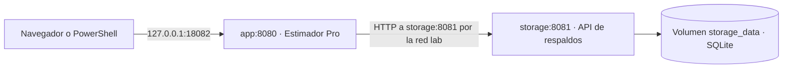

# Estimador Pro

Aplicación para planificar y dar seguimiento a proyectos de software mediante tareas, sprints y un cronograma de días hábiles.

## Funcionalidades

- Cronograma editable con festivos de Colombia y fechas programadas y reales.
- Seguimiento del avance de tareas y sprints, con filtro de pendientes.
- Dashboard operativo con indicadores y diagrama de Gantt por tarea.
- Informe de Avance con indicadores ejecutivos, ruta por sprint, módulos y detalle de trabajo.
- Exportación del informe de Avance a un HTML autónomo, listo para abrir o compartir sin instalar la aplicación.
- Guardado local, recuperación de datos e importación y exportación de respaldos JSON.
- Exportación del cronograma y su seguimiento a PDF.
- Conexión OAuth con GitLab, importación de issues y milestones, vista previa de cambios y comentarios en el informe de Avance.

## Entrega 1 · Escenario 3 con Docker

`app/` contiene el Dockerfile que compila el frontend con Node.js y arranca el servidor de Estimador Pro. `storage/` contiene una API en Python que guarda y lee respaldos en SQLite. Los dos servicios comparten la red `lab` de Docker Compose.



### 1. Configurar y construir

Abre Docker Desktop y ejecuta estos comandos en PowerShell desde la raíz del repositorio.

```powershell
if (-not (Test-Path .env)) { Copy-Item .env.example .env }
notepad .env
```

Completa `STORAGE_API_TOKEN` con un valor aleatorio. Puedes generar uno en PowerShell con `[guid]::NewGuid().ToString('N')`. Ambos servidores lo reciben como variable de entorno. `.env` queda excluido de Git y del contexto de compilación.

```powershell
docker build -f app/Dockerfile -t estimador-pro-app:escenario3 .
docker compose build
docker compose up -d --wait
docker ps --filter 'label=com.docker.compose.project=estimador-pro-escenario3'
docker network inspect estimador-pro-escenario3_lab
```

Abre `http://127.0.0.1:18082`. Si el puerto está ocupado, cambia `APP_PORT` en `.env`. Compose comprueba primero la salud de `storage` y después arranca `app`.

Si la compilación falla con `SELF_SIGNED_CERT_IN_CHAIN` y tu red usa una CA corporativa, usa el certificado público de la CA que ya confía tu equipo. Guárdalo en `.docker-local/npm-ca.pem` y pásalo a `docker build` con `--secret id=npm_ca,src=.docker-local/npm-ca.pem`. Para Compose, crea este `docker-compose.override.yml` local:

```yaml
services:
  app:
    build:
      secrets: [npm_ca]
secrets:
  npm_ca:
    file: ./.docker-local/npm-ca.pem
```

Docker monta la CA únicamente al instalar paquetes. Ambos archivos locales están excluidos de Git. Este ajuste depende de la red del equipo.

### 2. Guardar y leer un respaldo

1. En Estimador Pro, abre **Respaldos en SQLite** y pulsa **Guardar respaldo**.
2. Consulta el ID que devuelve la aplicación. Comprueba el nombre, los sprints y la descarga del JSON.
3. Ejecuta la prueba con datos ficticios y observa que el mismo ID aparece en la escritura y en la lectura.

```powershell
docker compose exec -T app node -e "require('node:dns').lookup('storage', (e, ip) => { if (e) throw e; console.log('storage ->', ip) })"
node scripts/verify-docker.mjs
```

El script necesita Node.js en el equipo. Si cambiaste `APP_PORT`, pásale la URL, por ejemplo `node scripts/verify-docker.mjs http://127.0.0.1:18083`. El `POST` debe devolver 201 y el `GET` debe devolver 200 con el mismo JSON. La aplicación usa `http://storage:8081` para ambos intercambios.

Para verificar el volumen, conserva el ID del respaldo ficticio, ejecuta `docker compose down` y vuelve a iniciar con `docker compose up -d --wait`. Consulta el mismo ID desde la página o con el siguiente comando.

```powershell
node scripts/verify-docker.mjs http://127.0.0.1:18082 <ID_DEL_RESPALDO>
```

Sustituye `<ID_DEL_RESPALDO>` por el UUID que devolvió la prueba. `docker compose down` conserva el volumen `storage_data`. `docker compose down -v` elimina los respaldos del volumen.

### 3. Verificar la integración continua

GitHub Actions construye las dos imágenes, levanta los servicios y ejecuta la prueba en cada push y pull request. El token se genera para cada ejecución. El resultado está en [Actions](https://github.com/elesAlexis/estimador-pro/actions).

## Desarrollo local

Requiere Node.js y npm.

```sh
npm install
npm run dev
```

## Verificación

```sh
npm test
npm run build
```

La aplicación utiliza React y Vite. Los datos del proyecto se guardan en el navegador. Para trasladarlos a otro equipo, utiliza un respaldo JSON.

El HTML se genera desde la vista **Avance**. Incluye los datos visibles en el informe y los comentarios públicos de GitLab que se hayan cargado. Las notas marcadas como internas no se incluyen en el archivo compartible.

## Configuración de GitLab

Copia `.env.example` como `.env` y completa únicamente valores públicos:

```env
VITE_GITLAB_URL=https://gitlab.miempresa.com
VITE_GITLAB_PROJECT=grupo/proyecto
VITE_GITLAB_CLIENT_ID=application_id_oauth
VITE_BASE_PATH=/ruta-pages/
```

Registra como URI de retorno la raíz exacta de desarrollo o de Pages. La aplicación OAuth debe ser pública/no confidencial, usar PKCE y tener alcance `api`. No agregues un Client Secret: las variables `VITE_` quedan incluidas en los archivos publicados. Los tokens se mantienen únicamente en memoria y se solicita conectar otra vez después de recargar.

La canalización `.gitlab-ci.yml` prueba y compila antes de ofrecer el despliegue manual de Pages. En un servidor propio deben estar habilitados Runner, Pages, HTTPS y el control de acceso correspondiente. La visibilidad privada del repositorio no garantiza por sí sola que Pages sea privado.

El repositorio contiene la aplicación y su documentación. Los datos de proyectos empresariales, respaldos y credenciales deben mantenerse fuera del repositorio público.
